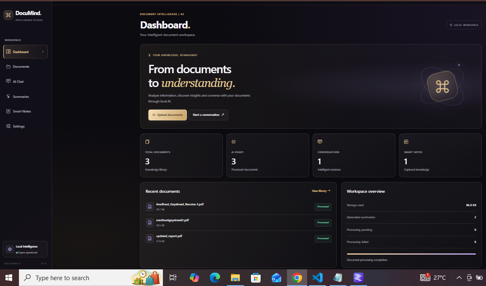
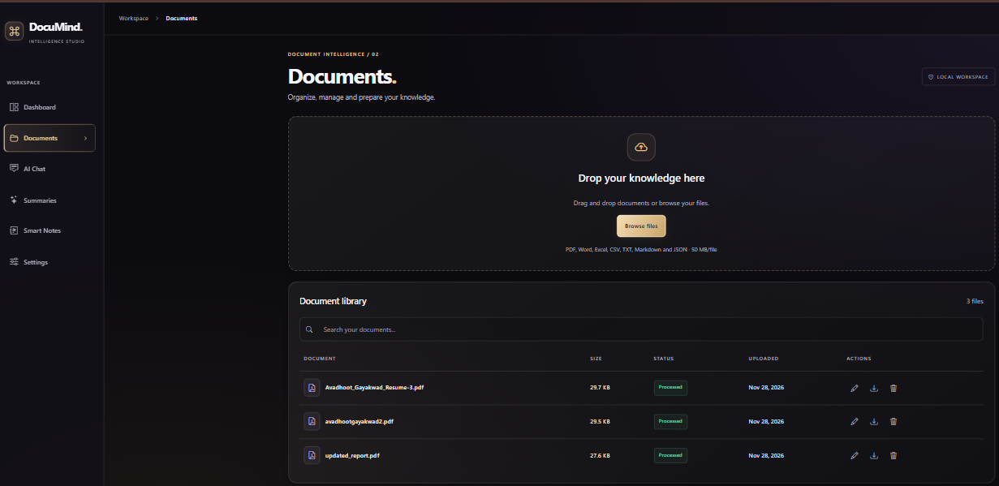
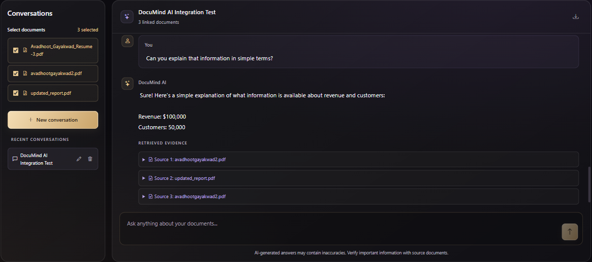
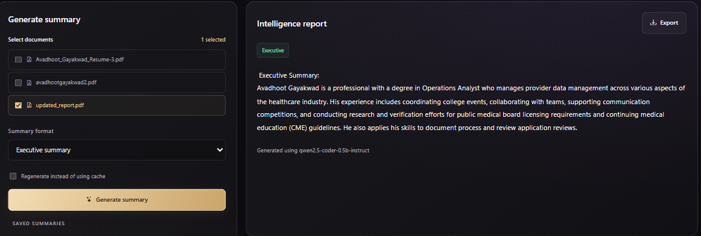
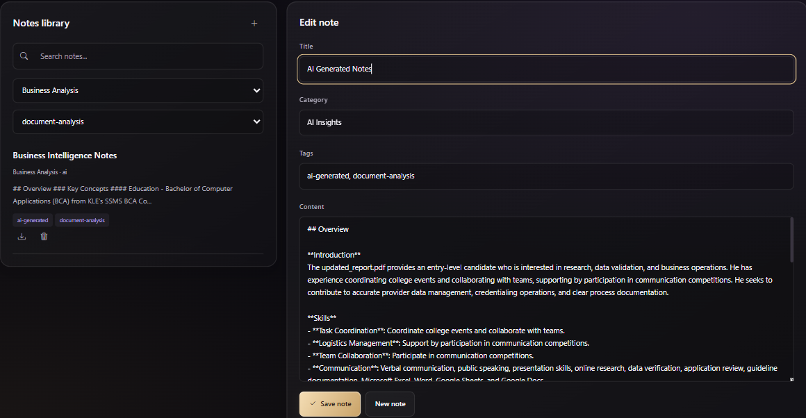
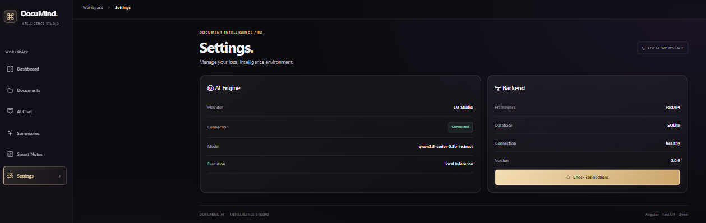

# DocuMind AI — Intelligence Studio

### Local AI-Powered Document Intelligence & Knowledge Management Platform

DocuMind AI is a full-stack document intelligence platform
designed to transform unstructured documents into searchable
knowledge, contextual conversations, actionable summaries and
organized notes using locally hosted artificial intelligence.



## Problem Statement

Organizations and individuals frequently work with large
collections of documents containing valuable information.

Manually searching, reading, summarizing and extracting
insights from these documents can be time-consuming and
inefficient.

DocuMind AI addresses this challenge through an integrated
document management and AI-powered knowledge workspace.

## Key Features

- Multi-format document upload and management
- Automated document text extraction
- Text normalization and overlapping chunk generation
- TF-IDF vectorization and cosine similarity retrieval
- Retrieval-Augmented Generation (RAG)
- Single and multi-document AI conversations
- Real-time response streaming using SSE
- Retrieved source attribution
- Persistent conversation history
- AI-powered document summarization
- Summary caching
- AI-generated structured notes
- Note management, categories and tags
- JSON export functionality
- Local LLM integration
- Responsive Obsidian Glass user interface

## Supported Document Formats

- PDF
- Microsoft Word DOCX
- Microsoft Excel XLSX and XLS
- CSV
- TXT
- Markdown
- JSON

## Technology Stack

| Layer | Technologies |
|---|---|
| Frontend | Angular, TypeScript, HTML5, CSS3 |
| Backend | Python, FastAPI |
| Database | SQLite, SQLAlchemy |
| Artificial Intelligence | LM Studio, Qwen |
| Information Retrieval | TF-IDF, Cosine Similarity |
| AI Architecture | Retrieval-Augmented Generation |
| Streaming | Server-Sent Events |
| Document Processing | PyMuPDF, python-docx, Pandas, OpenPyXL |
| Testing | Pytest |
| API Documentation | Swagger UI, OpenAPI |
| Version Control | Git, GitHub |

## System Architecture

```text
Angular Frontend
       |
       v
FastAPI REST API
       |
       +--------------------+
       |                    |
       v                    v
SQLite Database       Document Storage
                            |
                            v
                     Text Extraction
                            |
                            v
                     Text Chunking
                            |
                            v
                     TF-IDF Retrieval
                            |
                            v
                     Context Assembly
                            |
                            v
                     LM Studio / Qwen
                            |
                            v
                     Streaming Response
                            |
                            v
                     Angular Frontend
```

## Document Intelligence Workflow

1. Upload documents.
2. Validate file format and size.
3. Extract document content.
4. Normalize and divide text into overlapping chunks.
5. Vectorize document chunks using TF-IDF.
6. Rank relevant chunks using cosine similarity.
7. Construct a document-grounded context prompt.
8. Generate an answer using a locally hosted LLM.
9. Stream the response to the frontend.
10. Store conversation history and retrieved sources.

## Application Screenshots

### Document Management



### AI Document Chat



### Intelligent Summarization



### Smart Notes



### System Settings



### Responsive Interface


## Project Structure

```text
DocuMind-V2/
├── backend/
│   ├── app/
│   │   ├── api/
│   │   ├── core/
│   │   ├── models/
│   │   ├── schemas/
│   │   ├── services/
│   │   ├── utils/
│   │   ├── database.py
│   │   └── main.py
│   ├── tests/
│   ├── .env.example
│   └── requirements.txt
├── frontend/
│   └── src/
├── storage/
├── screenshots/
├── docs/
├── .gitignore
└── README.md
```

## Local Setup

### Prerequisites

- Python
- Node.js and npm
- Git
- LM Studio
- A compatible local language model

### Backend Setup

```powershell
python -m venv venv
.\venv\Scripts\Activate.ps1

python -m pip install -r backend\requirements.txt

cd backend

Copy-Item .env.example .env

python -m uvicorn app.main:app --reload
```

Backend URL:

http://localhost:8000

Interactive API documentation:

http://localhost:8000/docs

### Frontend Setup

Open a separate terminal:

```powershell
cd frontend
npm ci
npm start
```

Frontend URL:

http://localhost:4200

### Local AI Setup

1. Open LM Studio.
2. Load a compatible language model.
3. Start the local inference server on port 1234.
4. Configure the backend environment variables.
5. Verify connectivity through the Settings page.

## Environment Configuration

```env
APP_NAME=DocuMind AI
APP_VERSION=2.0.0
LM_STUDIO_BASE_URL=http://localhost:1234/v1
LM_STUDIO_MODEL=auto
MAX_UPLOAD_SIZE_MB=50
```

## Testing

Backend automated tests:

```powershell
cd backend
python -m pytest tests -v
```

Frontend production build:

```powershell
cd frontend
npm run build
```

## Engineering Challenges

- Handling multiple document formats through a unified
  extraction pipeline.
- Managing duplicate uploads using SHA-256 file hashing.
- Retrieving relevant information from multiple documents.
- Integrating local language models with asynchronous APIs.
- Implementing real-time AI response streaming.
- Maintaining persistent conversations and knowledge records.
- Designing a responsive glassmorphism interface without
  additional UI frameworks.

## Privacy and Security

- AI inference is performed locally through LM Studio.
- Documents and application records are stored locally.
- No paid cloud AI API is required.
- File uploads are validated.
- Private documents and database files are excluded from
  version control.

## Current Limitations

- AI answer quality depends on the selected local model.
- Scanned PDFs require OCR, which is not included.
- Legacy DOC extraction may require additional support.
- The application is intended for local, single-user operation.
- Production authentication and cloud deployment are outside
  the current project scope.

## Project Status

Version 2.0 — Local document intelligence application.

## Author

Avadhoot Gayakwad

Data Analytics | Full-Stack Development | Applied AI